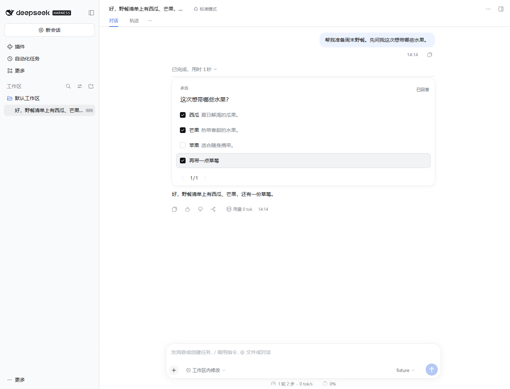
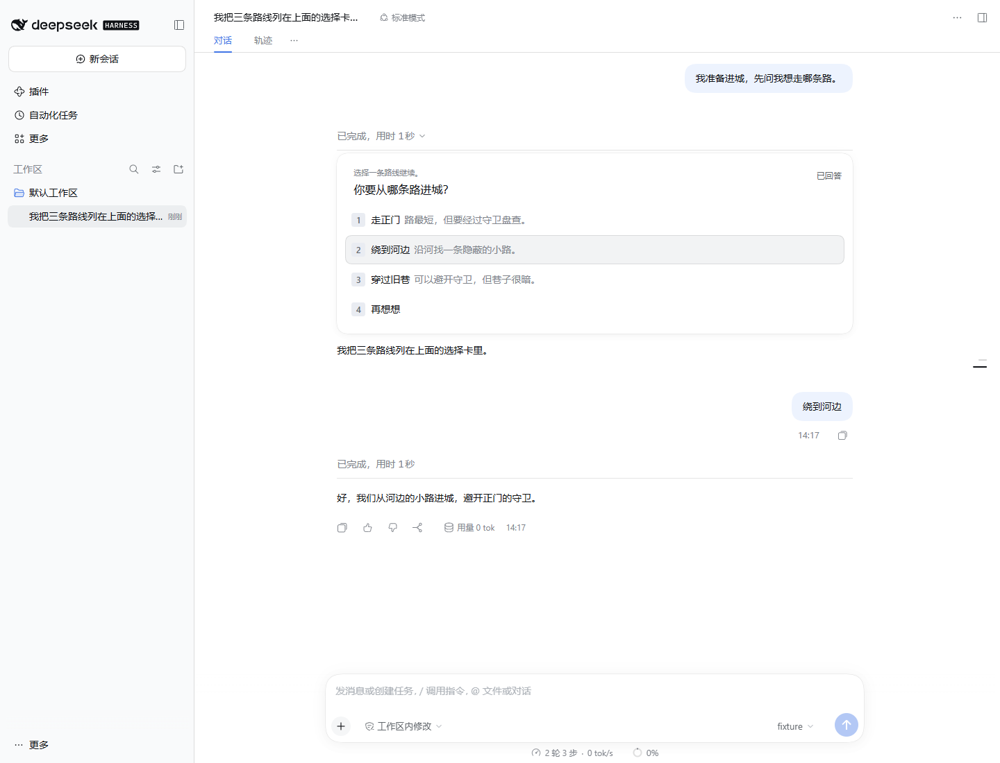

# dsh-answered-questions · Answered Questions for DeepSeek Harness

English | [简体中文](https://github.com/Ryuu-64/dsh-answered-questions/blob/main/README.zh-CN.md)

Keep the question, every option, and your answer visible in **DeepSeek Harness (DSH)** after you reply. Return to a conversation later and see what you chose, along with the alternatives.

## See it in action

After you answer a multiple-choice question, the card keeps your selections, the unselected options, and any extra text you entered. It uses DSH's native styling.

*Recorded in DSH 0.2.2-rc.3 with an example conversation and the current source version. The interface is in Simplified Chinese.*

## Install

Ask an AI assistant that can operate your computer:

> Install this plugin in my DSH setup, check compatibility, and confirm it is enabled: https://github.com/Ryuu-64/dsh-answered-questions

Supports **DSH 0.2.1-rc.3 and 0.2.2-rc.3**. Version **0.1.3** is available from source and has not been published to npm.

## Try it

Ask the assistant to use the native question tool, for example:

> Use ask_user_question to ask which fruits I want to bring. Let me select more than one and add anything else I want to bring.

1. Select two options in DSH's question panel, add a written answer, and submit.
2. Return to the chat. The complete card keeps both selections, the other options, and your text.
3. Refresh or reopen the conversation to review your answer again. Load earlier history if the question is not yet visible. When a request contains several questions, use the arrows at the bottom of the card to move between them.

For choice cards, also install [`@machine202502/dsh-choice@0.1.2`](https://www.npmjs.com/package/@machine202502/dsh-choice). Click an option to send your answer. After submission, all options remain visible and your selection stays marked:

*Shown with the interface in Simplified Chinese. The choice card comes from dsh-choice; Answered Questions preserves and restores selections submitted through this plugin.*

## What stays visible

| Question type | What you can review |
| --- | --- |
| Native single choice | The question, all options, and the selected option or written answer |
| Native multiple choice | The question, all options, checked selections, and extra text |
| Free text or skipped question | The original text or an explicit unanswered state |
| `dsh-choice` card | Text, image, or audio options, plus the selected option or “none of these” |

The plugin works automatically when enabled and needs no extra configuration. Open images to view them, or play audio manually.

- **Existing native questions can be reviewed** if DSH saved the complete question and result. Missing records are not filled with invented answers.
- **Old choice-card answers cannot be recovered automatically.** Earlier text without a link to its question is not treated as a recorded selection. Choosing again sends a new answer.
- **Submitted and queued does not mean answered.** The card shows an answer only after it enters the conversation history. If you remove a pending answer from the queue, you can choose again.
- **The plugin reads records from the current DSH connection** and does not send answers to an external model for processing. If a remote image or audio file becomes unavailable, the choice record remains, but the media may no longer open.

DSH 0.2.2-rc.3 also has short answer bubbles. When a complete review card is available, the plugin hides the corresponding bubble to avoid showing the answer twice.

## Feedback and further reading

Report problems in [GitHub Issues](https://github.com/Ryuu-64/dsh-answered-questions/issues), including your DSH version, question type, and steps to reproduce. Leave out secrets and private conversations.

- [Compatibility and history limits (Chinese)](https://github.com/Ryuu-64/dsh-answered-questions/blob/main/docs/compatibility.md)
- For development, run `npm run build` and `npm run check`. Browser regression tests are in [`scripts/e2e.mjs`](https://github.com/Ryuu-64/dsh-answered-questions/blob/main/scripts/e2e.mjs).
- [Acknowledgments](https://github.com/Ryuu-64/dsh-answered-questions/blob/main/NOTICE.md) · [MIT license](https://github.com/Ryuu-64/dsh-answered-questions/blob/main/LICENSE)
