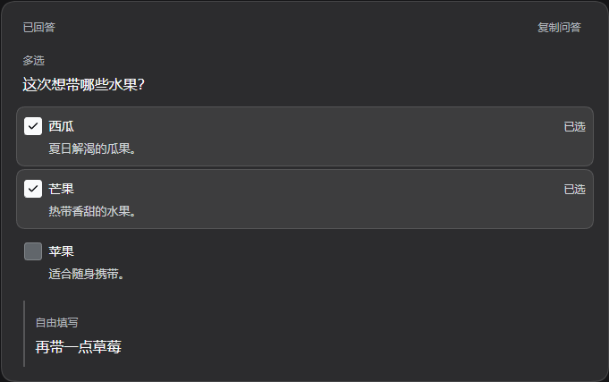
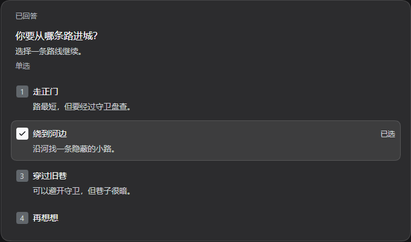

# dsh-answered-questions · 问答回看

回答完以后，**问题、全部选项和你的答案仍然留在 DSH 聊天里**。不用重新打开提问面板，也不用靠助手复述。

选中的项会打勾；没有选中的项及其说明保留显示。自由填写的内容会完整保留。界面使用 DSH 原生主题颜色、字体和选项样式，跟随深浅主题。



## 支持什么

| 提问方式 | 回看内容 |
| --- | --- |
| `ask_user_question` 单选 | 问题、所有选项、选中项，或自由填写的答案 |
| `ask_user_question` 多选 | 问题、所有选项、全部选中项，以及补充文字 |
| 自由填写 / 跳过 | 填写的原文，或明确的「未作答」状态 |
| `ask_user_choice` 选择卡 | 问题、全部文字/图片/音频选项、选中项或「都不选」 |

原生问答的操作方式保持 DSH 的习惯，提交后自动显示完整记录。选择卡直接点击选项发送，提交成功后锁定，避免重复回答。图片可打开查看，音频可手动播放。

本插件不额外注册一个提问工具。`ask_user_choice` 由
[`@machine202502/dsh-choice`](https://www.npmjs.com/package/@machine202502/dsh-choice)
提供；需要这种提问方式时，同时安装该插件。问答回看接管它的卡片显示与回答提交，让选择能够在聊天记录中恢复。



## 当前版本

包名：`@ryuu-64/dsh-answered-questions`。当前为 `0.1.0` 源码版本，尚未发布 npm。

兼容目标为 DSH **`0.2.1-rc.3`、`0.2.2-rc.3`**，选择卡适配 **`dsh-choice 0.1.2`**。
实测范围和限制见[兼容说明](docs/compatibility.md)及[测试记录](docs/test-report.md)。

## 记录怎样保留

- **原生问答**直接从 DSH 已保存的提问和结果恢复，安装前的历史也可显示。较早的记录需要先由 DSH 加载到聊天里。
- **选择卡**通过本插件提交后，消息来源会记录题目编号与选项位置。重新打开页面或聊天时，可恢复对应的选择。
- **「已提交，等待处理」**表示答案还在 DSH 队列中；进入聊天记录后才显示「已回答」。从队列移除未处理的答案后，可以重新选择。
- **旧版选择卡的历史答案**只有普通文字，没有题目编号。本插件不会猜它属于哪道题，会显示「尚无本插件记录的选择」。重新选择会发送一条新答案。

原生工具失败、题目仍待回答、记录不完整时，不会伪造选中状态。插件只处理当前 DSH 连接内的记录，不调用外部模型处理你的答案。

## 开发与验证

Node.js 22.19+ 或 24：

```sh
npm ci --ignore-scripts --legacy-peer-deps
npm run build
npm run check
npm pack
```

浏览器代码在 `src/`，构建生成并提交 `lib/client.js`。React 由 DSH 提供，不重复打包。
Host 模块在 `lib/`，依赖 DSH 自带的服务。

单元测试覆盖原生单选、多选、自定义文本、跳过、延迟回复、PTC、历史补载；选择卡测试覆盖精确关联、刷新恢复、重复提交、排队撤回和失败恢复。

`scripts/e2e.mjs` 在独立 DSH Web 配置档及临时浏览器中运行真实交互，使用本地确定性模型，不调用外部 AI。运行参数和已验证环境见[测试记录](docs/test-report.md)。

## 反馈

请到 [GitHub Issues](https://github.com/Ryuu-64/dsh-answered-questions/issues) 反馈，附上 DSH 版本、提问方式与复现步骤。

MIT · [作者与致谢](NOTICE.md)
