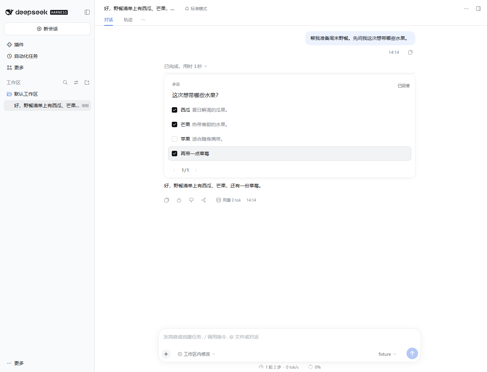
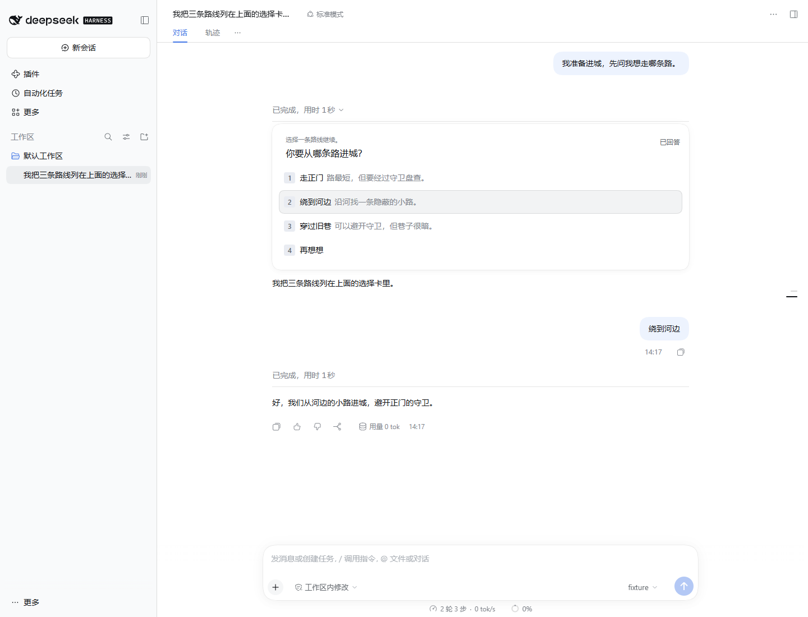

# dsh-answered-questions · 问答回看

[English](https://github.com/Ryuu-64/dsh-answered-questions/blob/main/README.md) | 简体中文

让 **DeepSeek Harness（DSH）** 在你回答后，仍把问题、全部选项和你的答案留在聊天里。过一会儿再看，也能知道当时选了什么、还有哪些选项。

## 看看效果

多选题回答后，选中项保留勾选，未选项和补充文字也一起留下。卡片沿用 DSH 的原生样式。



*DSH 0.2.2-rc.3 中的真实界面，使用示例对话；图片展示当前源码版本。*

## 当前版本与安装

**当前源码为 0.1.3，尚未发布 npm。** 现在按包名搜索安装还拿不到这个插件，请使用下面的本地包方式。

支持 DSH **0.2.1-rc.3、0.2.2-rc.3**。先确认 DSH 能正常聊天；使用 DSH 0.2.2-rc.3 的 CLI 时，Node.js 须为 **24.9.0 或更新的 24 系列版本**。只有需要 `ask_user_choice` 选择卡时，才需另外安装 [`@machine202502/dsh-choice@0.1.2`](https://www.npmjs.com/package/@machine202502/dsh-choice)。

以下源码安装需要 Git、npm，以及命令行中可用的 `dsh` 和 `pnpm`。

1. 克隆仓库，在仓库目录安装依赖并构建：

   ```sh
   git clone https://github.com/Ryuu-64/dsh-answered-questions.git
   cd dsh-answered-questions
   npm ci --ignore-scripts --legacy-peer-deps
   npm run build
   ```

2. 在仓库外新建一个输出目录，再把下面的路径替换为它的绝对路径：

   ```sh
   npm pack --pack-destination "<仓库外的输出目录>"
   ```

3. 安装生成的 `.tgz`。以下命令用于 DSH Web 的 `web` 配置档；路径替换为上一步实际生成的文件：

   ```sh
   dsh plugin --profile web add "<输出目录>/ryuu-64-dsh-answered-questions-0.1.3.tgz"
   ```

4. 保留这个 `.tgz` 文件，配置档会引用它。重启该 DSH 服务并刷新页面，在「插件」中确认“问答回看”已启用。桌面版请使用该版本提供的插件安装入口，不套用 `web` 配置档。

### 更新

本地包更新时，重新构建、打包并安装新的 `.tgz`，然后重启。它不会收到 npm 更新提示。

以后发布到 npm 的版本，在 DSH 0.2.2-rc.3 的「插件」→「问答回看」→「版本」中统一检查和安装更新。如果宿主未提供这个版本区块，请重新安装兼容版本。详见 [DSH 原生更新说明](https://github.com/deepseek-ai/deepseek-harness/blob/dsh-v0.2.2-rc.3/packages/client/ui-plugin-manager/README.zh.md#更新组合包)。

## 第一次使用

在聊天中请助手用原生提问工具给你一道多选题，例如：

> 请用 ask_user_question 问我这次想带哪些水果，允许多选，并让我补充其他要带的东西。

1. 在 DSH 提问面板勾选两项，填写补充文字，然后提交。
2. 回到聊天，查看保留下来的完整卡片：两项已勾选，其他选项仍可读，补充文字保持原样。
3. 刷新页面或重新打开这段聊天，仍可回看答案；较早的内容需要先加载历史。一次有多道题时，用卡片底部的箭头翻页。

使用 `dsh-choice` 时，直接点选择卡上的选项发送答案，提交后保留全部选项和原先的选择：



*选择卡由 dsh-choice 提供；问答回看负责保留和恢复通过本插件提交的选择。*

## 常用操作与限制

| 提问方式 | 回看时能看到什么 |
| --- | --- |
| 原生单选 | 问题、全部选项及选中项，或填写的答案 |
| 原生多选 | 问题、全部选项、勾选状态及补充文字 |
| 自由填写或跳过 | 填写原文，或明确的“未作答”状态 |
| `dsh-choice` 选择卡 | 文字、图片或音频选项，以及选中项或“都不选” |

启用后自动工作，不需要额外配置。图片可打开查看，音频可手动播放。

- **已有原生问答可以回看**，前提是 DSH 保存了完整题目和结果。缺失记录不会被补写成看似真实的答案。
- **旧选择卡的答案无法自动补认**：没有题目关联的旧文字不会被猜成一次选择。重新选择会发送新答案。
- **“已提交，等待处理”还不是“已回答”**。答案进入聊天记录后才显示已回答；从队列移除尚未处理的答案后，可以重新选择。
- **只读取当前 DSH 连接内的记录**，不调用外部模型处理答案。远程图片或音频失效后，选择记录仍保留，媒体本身可能无法打开。

DSH 0.2.2-rc.3 已有简短答案气泡；完整回看卡片可用时，插件会隐藏对应气泡，避免重复显示。

## 反馈与详细说明

遇到问题请到 [GitHub Issues](https://github.com/Ryuu-64/dsh-answered-questions/issues) 反馈，附上 DSH 版本、提问方式和复现步骤。请勿公开密钥或私密对话。

- [兼容范围与历史记录边界](https://github.com/Ryuu-64/dsh-answered-questions/blob/main/docs/compatibility.md)
- 开发时运行 `npm run build` 和 `npm run check`；浏览器回归入口为 [`scripts/e2e.mjs`](https://github.com/Ryuu-64/dsh-answered-questions/blob/main/scripts/e2e.mjs)。
- [作者与致谢](https://github.com/Ryuu-64/dsh-answered-questions/blob/main/NOTICE.md) · [MIT 许可证](https://github.com/Ryuu-64/dsh-answered-questions/blob/main/LICENSE)
